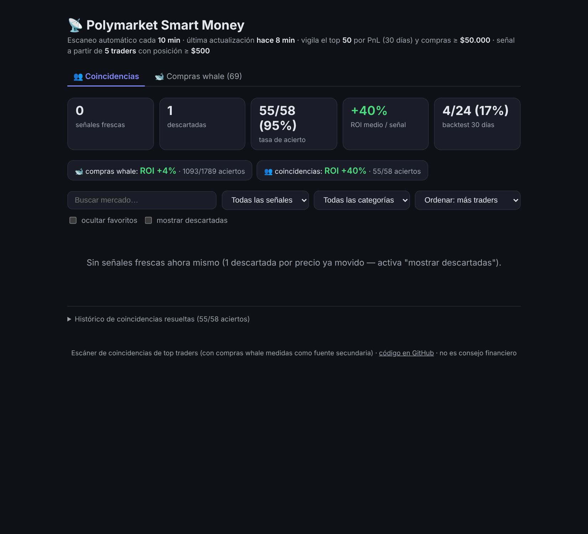
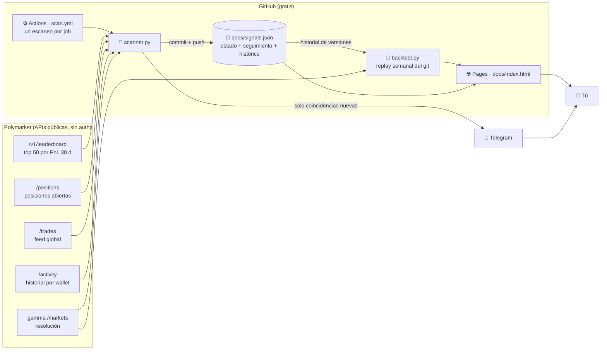
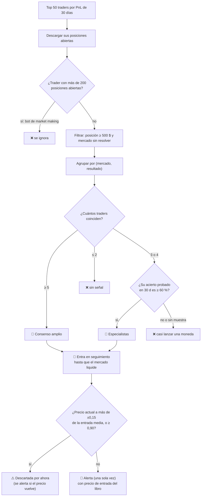
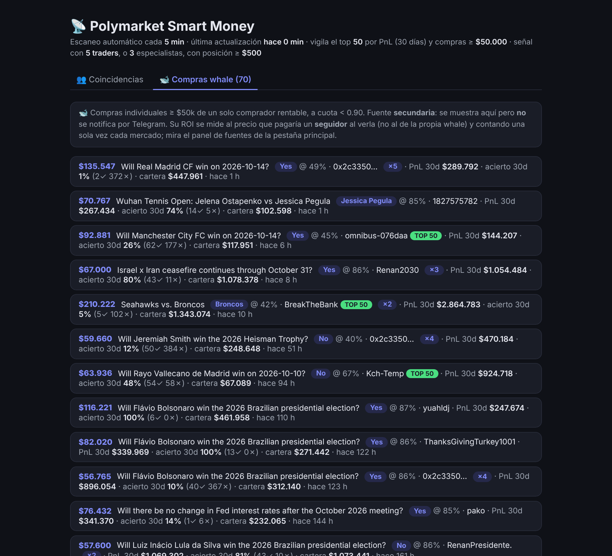
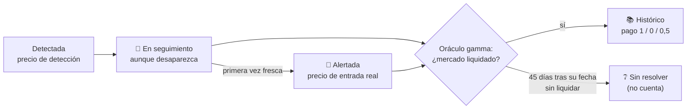
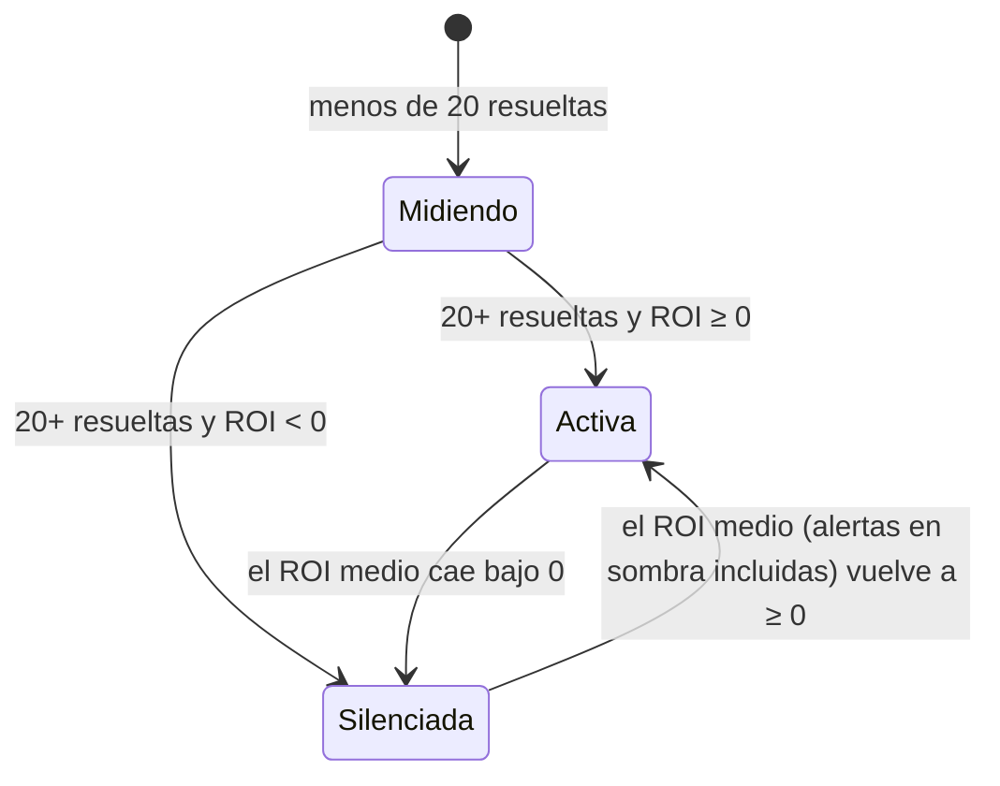
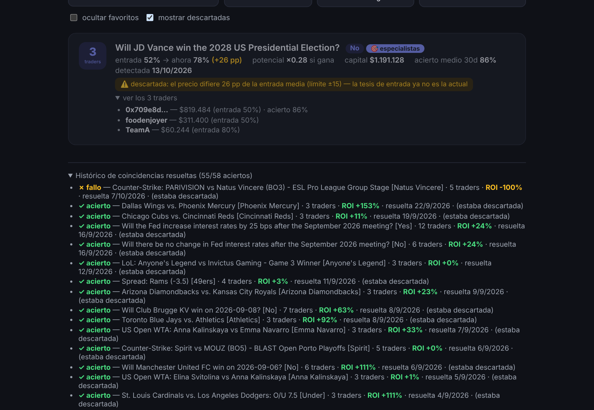
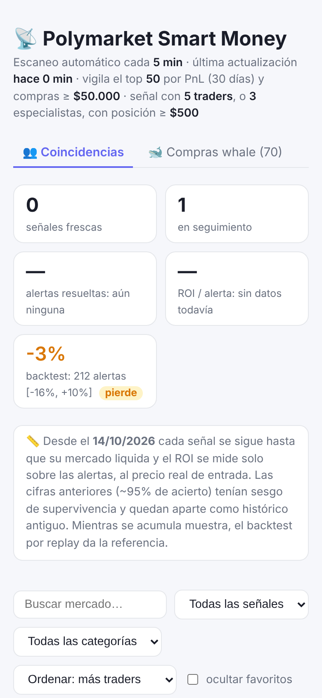

# 📡 Polymarket Smart Money

[](https://github.com/edulabrador/polymarket-smart-money/actions/workflows/scan.yml)
[](https://edulabrador.github.io/polymarket-smart-money/)


**Monitor de "dinero inteligente" en [Polymarket](https://polymarket.com).** Vigila a
los 50 traders más rentables del último mes y avisa cuando varios de ellos apuestan
lo mismo (mismo mercado y mismo resultado). Además lista las compras individuales
gigantes ("whales") de compradores rentables y **mide el ROI real de cada fuente**
para saber, con datos y no con intuición, si seguirlas da dinero.

📊 **Web en vivo: [edulabrador.github.io/polymarket-smart-money](https://edulabrador.github.io/polymarket-smart-money/)**



> ⚠️ Herramienta de análisis de datos públicos. **No apuesta, no ejecuta órdenes y no
> es consejo financiero.** Lee la sección [Limitaciones](#-limitaciones-y-riesgos)
> antes de sacar conclusiones de las cifras.

---

## Índice

- [La idea en 30 segundos](#-la-idea-en-30-segundos)
- [Resultados: qué se sabe y qué no](#-resultados-qué-se-sabe-y-qué-no)
- [Arquitectura](#-arquitectura)
- [Cómo se genera una señal](#-cómo-se-genera-una-señal)
- [Fuente secundaria: compras whale](#-fuente-secundaria-compras-whale)
- [Cómo se mide la rentabilidad](#-cómo-se-mide-la-rentabilidad)
- [Backtest por replay](#-backtest-por-replay)
- [Tres estrategias en una herramienta](#-tres-estrategias-en-una-herramienta)
- [La web](#-la-web)
- [Notificaciones por Telegram](#-notificaciones-por-telegram)
- [Configuración](#%EF%B8%8F-configuración)
- [Puesta en marcha](#-puesta-en-marcha)
- [Estructura del repositorio](#-estructura-del-repositorio)
- [Limitaciones y riesgos](#-limitaciones-y-riesgos)
- [Estado y referencias](#-estado-y-referencias)

---

## 💡 La idea en 30 segundos

En un mercado de predicción el precio es la probabilidad que el mercado asigna a un
resultado: comprar "Sí" a 0,30 $ significa que el mercado cree que ocurre un 30 % de
las veces, y si ocurre cobras 1 $.

**Hipótesis:** si **varios** de los traders más rentables están posicionados en el
**mismo lado** de un mercado, ese lado gana más a menudo de lo que dice su precio.
Un solo trader puede tener suerte o una apuesta puntual; cinco coincidiendo sin
coordinarse es información.

El proyecto no da la hipótesis por buena: **sigue cada señal hasta que su mercado
liquida, calcula cuánto habrías ganado o perdido siguiendo cada alerta al precio real
de entrada y publica el resultado con su intervalo de confianza.** Las fuentes que no
pagan se silencian solas.

---

## 📈 Resultados: qué se sabe y qué no

> **Estado honesto (octubre de 2026): con las reglas actuales, seguir las alertas NO ha
> sido rentable.** El backtest por replay de julio a octubre da un ROI de **−3 %** por
> alerta: los top traders aciertan casi exactamente lo que ya dice el precio.

Hasta el 14 de octubre de 2026 la web mostraba un **95 % de acierto y +40 % de ROI**.
Una auditoría del código y de las 10.900 versiones guardadas de `signals.json` mostró
que esas cifras estaban **infladas por un sesgo de supervivencia**:

- Una señal solo recibía veredicto si seguía activa justo antes de resolver. Cuando una
  apuesta va perdiendo, el valor de las posiciones cae por debajo de 500 $, los traders
  dejan de contar y la señal **desaparecía sin registrarse**. Las ganadoras, en cambio,
  llegaban al final y se registraban.
- De **383** señales detectadas solo **58** tenían resultado, y de esas 58 solo **5** se
  habían notificado de verdad por Telegram.
- Las señales de especialistas (3-4 traders) **nunca se notificaban** por un fallo en el
  filtro de destinatarios.

Todo eso está corregido (ver [Cómo se mide la rentabilidad](#-cómo-se-mide-la-rentabilidad)).
El histórico antiguo se conserva marcado como `legacy`, visible aparte en la web, y
**no cuenta en ninguna métrica**.

### Backtest por replay (15-07-2026 a 14-10-2026)

> Esta tabla es una foto del 14-10-2026. Las cifras al día están en la web y en
> `docs/backtest.json`, que se regeneran cada lunes.

Reglas actuales aplicadas a las 10.920 versiones guardadas; resultado según el oráculo
de gamma; entrada = precio guardado + 1 céntimo. 383 señales, 356 resueltas, 27 pendientes.

| Grupo | Resueltas | Acierto | El precio implicaba | ROI medio | IC95 | Veredicto |
|---|---:|---:|---:|---:|---|---|
| **Todas las alertas** | 212 | 55,7 % | 56,1 % | **−3,2 %** | −16 % a +10 % | pierde |
| Alertas, entrando 5-10 min tarde | 212 | 55,7 % | 56,1 % | −3,3 % | −21 % a +15 % | pierde |
| 🎯 Especialistas (3-4 traders) | 194 | 55,2 % | 56,7 % | **−6,1 %** | −19 % a +7 % | pierde |
| 👥 Consenso amplio (5 o más) | 18 | 61,1 % | 49,0 % | +29 % | −38 % a +96 % | sin muestra |
| Todas las detectadas | 356 | 68,8 % | 67,4 % | −2,6 % | −11 % a +5 % | pierde |

Intervalos robustos por evento (212 alertas en 180 eventos distintos). Cartera simulada:
212 apuestas de 100 $ → **−669 $**, con una caída máxima de 2.001 $ y hasta 1.300 $
inmovilizados a la vez.
Sin ningún coste de entrada el ROI seguiría en −1,2 %.

Lectura:

- **No hay ventaja medible.** Coincidir con los top traders acierta lo mismo que el
  precio de mercado. Su beneficio en el leaderboard no se traslada a quien les copia
  minutos u horas después.
- **Por eso las alertas de especialistas no se envían por defecto** (`ALERT_TIERS=amplio`):
  se registran en sombra y se sigue midiendo su ROI en vivo.
- **El consenso amplio da +29 %, pero con 18 casos** el intervalo va de −39 % a +97 %. Es
  compatible con no tener ninguna ventaja. Es lo único que se sigue enviando, y el
  histórico en vivo dirá si se sostiene.
- **Validación fuera de la muestra:** se probaron 45 combinaciones de reglas con la
  primera mitad (hasta el 30-08-2026). La mejor dio **+17,7 %** (31 alertas); aplicada a
  la segunda mitad dio **−18,2 %** (38 alertas). Las reglas actuales pasan de +3,5 % a
  **−11,8 %**. Lo que parecía funcionar en una mitad era azar: no hay un ajuste de
  filtros que rescate esta señal.

### Dos fuentes de verdad

Desde la corrección hay dos fuentes de verdad, ambas en la web:

| Fuente | Qué mide | Cuándo es fiable |
|---|---|---|
| **Histórico en vivo** | ROI de cada alerta al precio real de entrada (libro de órdenes), resultado según el oráculo | Cuando haya ≥ 20 alertas resueltas y el intervalo de confianza no incluya el 0 |
| **Backtest por replay** | Las reglas actuales aplicadas a lo que el escáner vio en cada momento desde julio, resultado según el oráculo | Ya, con las limitaciones que se publican junto al resultado |

Cómo leer las cifras:

- **El ROI importa más que la tasa de acierto.** Acertar un favorito comprado a 0,95
  solo paga +5 %; fallar cuesta −100 %. Por eso la web compara siempre el acierto con la
  probabilidad que implicaba el precio de entrada: solo hay ventaja si se acierta **más**.
- **"Rentable" exige que todo el intervalo de confianza al 95 % esté por encima de 0.**
  Una media positiva con un intervalo que cruza el 0 es "no concluyente".
- **La fuente "primer movimiento"** (copiar a un único top trader) se retiró en julio
  porque los datos la mostraron perdedora (−42 % sobre 91 resueltas). Ojo: esa cifra se
  midió con el método antiguo, así que también es aproximada.

---

## 🏗 Arquitectura

Todo funciona **sin servidor y sin coste**: GitHub Actions hace de "cron", el propio
repositorio hace de base de datos (`docs/signals.json` versionado) y GitHub Pages
sirve la web.



Por qué así:

- **Polymarket está bloqueado en España** (DGOJ): los ISP españoles no resuelven
  `*.polymarket.com`. Los runners de GitHub Actions están en EE. UU. y no tienen ese
  problema, así que el escáner corre allí.
- **Un escaneo por job.** Cada ejecución de `scan` hace un solo escaneo (~1 min), guarda
  y termina. Antes un job de 5 h 30 dormía 9 de cada 10 minutos y el cron (cada 3 h)
  lo cancelaba a medias: el runner estaba ocupado 24 h al día para trabajar ~2 h. El
  cron (`*/10`) viene **comentado** en `scan.yml`: hay que descomentarlo para que corra
  solo. GitHub retrasa o salta algunas ejecuciones en horas punta, así que la cadencia
  real es de 10-20 min. En repos públicos los minutos de Actions son gratis.
- **Nunca se cancela un escaneo a medias** (`cancel-in-progress: false`): si uno tarda,
  el siguiente espera. Cancelarlo podía enviar un aviso de Telegram sin llegar a
  guardar el estado y repetirlo después.
- **El estado vive en git**: cada escaneo hace commit de `signals.json`. Sirve de base
  de datos, de fuente de la web y, sobre todo, de **grabación punto a punto** de lo que
  el escáner vio: el backtest reproduce esas versiones sin mirar el futuro.
- **Solo librería estándar de Python** (`urllib`, `json`): nada que instalar.

---

## 🔬 Cómo se genera una señal

Cada 10 minutos `scanner.py` recorre este embudo:



Los pasos en detalle:

1. **Leaderboard.** Se descargan los 50 mejores traders por beneficio de los últimos
   30 días (`/v1/leaderboard?timePeriod=MONTH&orderBy=PNL`).
2. **Filtro anti-bots.** Los primeros puestos suelen ser bots que operan en cientos de
   mercados al día; sus posiciones no expresan una opinión. Un trader con más de
   `MAX_POSITIONS_PER_TRADER` (200) posiciones abiertas no cuenta.
3. **Filtro de ruido.** Solo cuentan posiciones de al menos `MIN_POSITION_USD` (500 $)
   en mercados no resueltos.
4. **Dos niveles de señal**, para encontrar más oportunidades sin perder fiabilidad:
   - **👥 Consenso amplio:** ≥ `MIN_USERS` (5) traders top en el mismo lado.
   - **🎯 Especialistas:** solo `MIN_USERS_SPECIALIST` (3) coinciden, pero su tasa de
     acierto **demostrada** en 30 días es ≥ `SPECIALIST_MIN_WINRATE` (60 %). Se mide en
     la categoría del mercado (deportes, política, cripto u otras) si hay muestra
     suficiente y, si no, en global. Adelanta la señal exigiendo gente que gana, no
     más gente.
5. **Descarte por deriva de precio.** Si el precio actual se ha alejado más de
   `MAX_PRICE_DRIFT` (0,15) del precio medio al que entraron los traders, la oportunidad
   que ellos vieron ya no existe: o ya ganaron ese tramo o el mercado les lleva la
   contraria. La señal se marca **descartada** y no se alerta mientras siga así; si el
   precio vuelve a la zona buena, se alerta entonces (antes se perdía para siempre).
6. **Especialización por categoría.** El historial de cada trader se desglosa por
   categoría (heurística por palabras del título). Un 70 % de acierto en deportes dice
   mucho en un partido y poco en unas elecciones, así que cada señal muestra el acierto
   de sus traders **en esa categoría**. Con menos de 5 mercados resueltos no se afirma nada.
7. **Momento de entrada.** Para cada señal nueva se mira en `/activity` cuándo compró
   cada trader ese mercado. `recentEntrants` cuenta cuántos compraron en las últimas
   24 h: cuatro traders entrando hoy no es lo mismo que cuatro posiciones de hace un mes.
8. **Ventaja estimada (`edgeEst`).** Media de la ventaja de sus traders frente al precio
   que pagaron (ver abajo). `pEst = precio + edgeEst` es una probabilidad estimada. Es
   una heurística **sin validar**: se registra en cada alerta para que el histórico
   diga si predice algo, y solo filtra si defines `MIN_EDGE`.

### Cómo se mide el acierto de un trader

Polymarket no da directamente "este trader acertó X de Y". Se reconstruye desde el feed
`/activity` del wallet en los últimos 30 días:

- **Ganadas:** canjes `REDEEM` con pago. Solo canjeas con pago si tienes el lado ganador.
- **Perdidas:** posiciones en mercados ya resueltos que siguen en `/positions` sin valor.

Usar solo `/positions` daba un 0 % falso por **sesgo de supervivencia**: las posiciones
ganadoras se canjean y desaparecen de la lista; solo quedan las perdedoras.

La tasa de acierto premia a quien apuesta a favoritos (acertar el 90 % comprando a 0,95
pierde dinero). Por eso también se calcula la **ventaja frente al precio pagado**: por
cada mercado resuelto con precio de compra conocido suma `1 − precio` si ganó y
`0 − precio` si perdió. Con pocas apuestas la media se **encoge hacia 0**
(`suma / (n + 10)`): tres aciertos a 0,20 no dan +80 % de ventaja, dan +18 %.

---

## 🐋 Fuente secundaria: compras whale

Además de las coincidencias, el escáner lee el **feed global de trades** buscando
compras individuales grandes:

| Filtro | Valor por defecto | Motivo |
|---|---|---|
| Importe mínimo | `WHALE_MIN_USD` = 50 000 $ | Solo dinero con convicción |
| Precio máximo | `MAX_ALERT_PRICE` = 0,90 | Comprar a 0,99 no tiene recorrido ni aporta información; era la mayor fuente de ruido |
| **PnL neto 30 d del comprador** | > 0 | Ver abajo |
| Acierto (si no hay PnL suficiente) | `WHALE_MIN_WINRATE` = 55 % con ≥ 5 mercados | Respaldo cuando falta historial de dinero |

**Filtro de calidad por dinero, no por número de apuestas.** Se calcula el beneficio
neto de 30 días del comprador como flujo de caja real: lo que entra (ventas y canjes)
menos lo que sale (compras) más el valor de mercado de lo que sigue abierto. Una whale
con **PnL neto negativo no se guarda ni se muestra en ningún sitio**. Alguien que ganó
cincuenta apuestas de 50 $ pero perdió una de 20 000 $ va en negativo, y la tasa de
acierto por sí sola no lo detectaba. Las recompensas de market making (rewards,
rebates) se ignoran: se mide habilidad apostando, no minería de liquidez.

Etiquetas que verás en la web:

- **🕵 LONGSHOT:** compra a precio ≤ `LONGSHOT_MAX_PRICE` (0,30). Mucho dinero apostando
  a algo que el mercado considera improbable es la señal más informativa (posible
  información privilegiada).
- **TOP 50:** el comprador está además en el top vigilado.
- **×N:** cuántas compras grandes lleva ese wallet en la ventana reciente.

**Cómo se mide su ROI.** La entrada es el precio que pagaría un **seguidor** al ver la
compra (el ask del libro en ese momento, o el precio de la whale + `ENTRY_COST`), no el
precio de la propia whale, que nadie que la siga puede conseguir. Varias compras en el
mismo mercado y lado cuentan **una sola vez**: no son apuestas independientes.



---

## 💰 Cómo se mide la rentabilidad

### Seguimiento persistente y oráculo único



- Cada señal (mercado + resultado) entra en `tracked` la primera vez que se detecta y
  **se sigue hasta que su mercado liquida**, aunque los traders salgan antes. Si
  desaparece y vuelve, sigue siendo la misma señal con su precio de detección original.
- El resultado lo da **siempre el oráculo** (gamma `/markets`: `closed` y
  `outcomePrices`). Es estricto: un mercado cerrado con precios intermedios (0,97/0,03)
  aún no está liquidado y no da veredicto. Los mercados anulados pagan 0,5.
- **Se alerta una sola vez por señal**, en el primer escaneo en que es fresca.

### Precio de entrada real

Al alertar se lee el **libro de órdenes del CLOB** y se calcula el precio medio de
comprar `PAPER_STAKE` (100 $) barriendo los asks. Si el libro no responde, se usa el
precio de mercado + `ENTRY_COST` (0,01). Ese es el precio con el que se mide el ROI de la
alerta; el precio medio de `/positions` sale siempre más barato de lo que un seguidor
puede conseguir.

### ROI y su intervalo de confianza

```
ROI = pago / precio_de_entrada − 1        (pago = 1 si gana, 0 si pierde, 0,5 si se anula)
```

| Precio de entrada | ROI si gana | ROI si pierde | Acierto necesario para no perder |
|---:|---:|---:|---:|
| 0,95 | +5 % | −100 % | 95 % |
| 0,70 | +43 % | −100 % | 70 % |
| 0,30 | +233 % | −100 % | 30 % |

La última columna es la clave: **una fuente solo es rentable si acierta más que el
precio al que entra.** Cada grupo de alertas se publica con:

- `hitRate` frente a `avgEntry`: acierto real frente al implícito en el precio.
- `avgRoi` con su **IC95 robusto por evento** y la mediana. Ganador, hándicap y
  más/menos de un mismo partido no son apuestas independientes: el intervalo se calcula
  agrupando por evento (`eventSlug`), lo que lo ensancha cuando hay varias apuestas del
  mismo partido. Se publica también cuántos eventos distintos hay (`events`).
- **Veredicto:** *sin muestra* (< 20), *pierde* (media < 0), *no concluyente* (el IC
  incluye el 0) o *rentable* (todo el IC por encima de 0).

Hay grupos separados para **todas las alertas**, **por nivel** (amplio, especialistas),
**especialistas por criterio** (acierto o ventaja), **whales**, **investigación** (todas
las detectadas, con entrada en la detección) y **compras nuevas** (ver abajo). Los de
investigación sirven para estudiar, nunca deciden nada.

**Whales.** Cada whale que pasa el filtro entra en `whalesPending` y se mide cuando su
mercado liquida, aunque ya no se muestre en la web (que enseña las 400 más recientes).
Así las de mercados largos también cuentan. Sin fecha de fin conocida, se consulta el
oráculo una vez por hora; caducan sin medirse pasados 400 días.

### Compras nuevas de los top traders (investigación)

La hipótesis con más posibilidades de dar ventaja es **entrar cuando ellos entran**, no
cuando una posición lleva días abierta. Cada escaneo compara el tamaño (en acciones, no
en valor) de las posiciones de cada top trader con el escaneo anterior:

- Una posición nueva o que crece un 20 % o más con al menos `ENTRY_MIN_USD` (1.000 $)
  añadidos, a precio < 0,90, es una **compra nueva**.
- Se registra una por mercado y lado cada 24 h; si otro top trader entra en el mismo, se
  suma a la misma compra (`entrada:2+`).
- Se mide con el oráculo al precio del escaneo + coste, igual que todo lo demás, en
  `docs/entries.json`. **No se notifica**: primero hay que ver si paga.

Los grupos `entrada`, `entrada:ventaja+` (de traders con ventaja positiva frente al
precio) y `entrada:2+` aparecen en el panel de fuentes cuando hay resueltas.

### Cartera simulada

`paper` simula apostar `PAPER_STAKE` en cada alerta: PnL, **caída máxima** desde un pico
(lo que habrías tenido que aguantar) y **capital inmovilizado** (máximo de apuestas
abiertas a la vez × apuesta).

### Gate auto-corrector

Cada grupo de alertas (global y por nivel) con ≥ `SOURCE_MIN_SAMPLE` (20) resueltas y
**ROI medio negativo** deja de notificar por Telegram. Mientras está silenciado sigue
alertando **en sombra** (se registra con su precio, sin enviarse), así que puede
reactivarse solo si los datos nuevos lo justifican.



---

## 🔁 Backtest por replay

`backtest.py` (workflow `backtest`, semanal y manual) recorre **todas las versiones de
`docs/signals.json` guardadas en git** y aplica las reglas de alerta actuales a lo que
el escáner vio en cada momento:

1. Detección: la primera versión en que aparece la señal.
2. Alerta: la primera versión en que es fresca y < 0,90. Entrada = precio guardado +
   `ENTRY_COST`. Variante **con retraso**: precio de la versión siguiente.
3. Resultado: oráculo de gamma, igual que en vivo.

Publica en `docs/backtest.json` los grupos (alertadas, con retraso, por nivel,
detectadas, descartadas al nacer, favoritos), la **sensibilidad del ROI al coste de
entrada** (0 a 3 céntimos), la cartera simulada (ordenada por la hora real de cierre de
gamma cuando existe) y una fila por señal.

**Antes del partido o en directo.** Gamma da la hora de inicio de los mercados deportivos
(`gameStartTime`), también de los ya cerrados. Cada alerta se clasifica en `previa`
(alertada antes de empezar), `directo` (ya empezado, donde 10 minutos de retraso pesan
mucho) o `sin_hora` (política, cripto, largo plazo). En vivo se guarda en cada señal y
compra nueva; en el backtest se reconstruye para todo el histórico.

**Validación fuera de la muestra (`walkForward`).** Ajustar filtros mirando el mismo
resultado que se quiere predecir siempre encuentra algo "rentable" por azar. Por eso el
backtest prueba 135 combinaciones de reglas (deriva máxima, precio máximo, traders
mínimos y fase del partido) **solo con la primera mitad del periodo**, elige la mejor, y la mide **solo con
la segunda mitad**. Si la regla tenía ventaja real, debe seguir ganando en la prueba;
si no, se cae. Se publica también el resultado de las reglas actuales en esa misma
segunda mitad.

**Por qué es fiable y el anterior no:** el backtest antiguo elegía a los traders con el
leaderboard de *hoy* (ya seleccionado por cuánto ganaron en ese periodo) y reconstruía
sus coincidencias sin precio de entrada. El replay solo usa lo que existía en cada
momento. Sus límites se publican con el resultado: las reglas de detección de cada época
(antes del 22-07-2026 solo había consenso amplio), la entrada sin libro histórico y la
hora de resolución aproximada.

---

## 🧪 Tres estrategias en una herramienta

Ya que el escáner recorre Polymarket cada 10 minutos, se aprovecha para probar tres
ideas de negocio distintas **con la misma vara de medir** (oráculo, ROI al precio de
entrada, IC95 por evento y comparación primera mitad / segunda mitad). Es un **banco de
pruebas**: cada estrategia registra sus apuestas en sombra, sin enviar nada, y solo
debería pasar a Telegram cuando sus datos demuestren que gana fuera de la muestra.

| Pestaña | Estrategia | Idea | Estado |
|---|---|---|---|
| 🧠 Smart money | **C** (la del proyecto) | Seguir a los top traders: coincidencias y, sobre todo, **compras nuevas** en el momento en que entran | Coincidencias: sin ventaja en el backtest. Compras nuevas: midiendo desde el 14-10-2026 |
| 📐 Sesgos de precio | **B** | Sesgo favorito-longshot: ¿se pagan de más los improbables y de menos los casi seguros? | ~2.600 resueltas a ROI ~0%: sin sesgo aprovechable. Sigue en muestra 1 de cada 5 |
| 📊 Cuotas de casas | **A** | Comprar cuando Polymarket da bastante menos probabilidad que Pinnacle o Betfair | Necesita `ODDS_API_KEY` |

**C · Smart money (prioridad).** Además de las coincidencias, registra cada compra nueva
de un top trader (sin coberturas) y la mide. Para elegir a quién seguir usa su
**historial propio medido**: el ROI de sus compras anteriores ya resueltas, calculado solo
con lo que había antes de cada compra (`entrada:historial+`, a partir de 5 resueltas).
Eso es elegir traders fuera de la muestra, no por el beneficio del mes. La tabla de
wallets de la pestaña muestra ese historial.

**B · Sesgos de precio.** Uno de cada `BIAS_SAMPLE` (5) mercados de corto plazo (que
terminan en 7 días o menos) que aparecen en las carteras vigiladas, elegido por un hash de
su id (siempre los mismos), se registra **una vez** con su precio y se mide por
tramos (0,01-0,10 … 0,90-0,99). Si el sesgo existe, los tramos altos darán ROI positivo
y los bajos negativo. Universo: los mercados que tienen los wallets vigilados, no todo
Polymarket.

**A · Cuotas de casas.** Cada 8 h (configurable) descarga de
[The Odds API](https://the-odds-api.com) las cuotas 1X2 de Pinnacle y Betfair para los
deportes de `ODDS_SPORTS` y les quita el margen. En la misma pasada pide a Polymarket
(gamma, por liga) **todos** sus partidos de esas competiciones que empiezan en los
próximos 3 días, con sus mercados de ganador y empate. Ya no depende de que algún top
trader tenga posición en ese partido, que era por lo que casi nunca se emparejaba nada.
Si Polymarket infravalora un lado en `ODDS_MIN_EDGE` (3 puntos) o más tras coste, se
registra en sombra (una vez por mercado). Solo cuenta antes del partido: en directo, unas
cuotas de hace horas no sirven. Para activarla: crea una cuenta en The Odds API (tiene
plan gratuito con un límite mensual de peticiones) y añade la clave como secret
`ODDS_API_KEY` en *Settings → Secrets and variables → Actions*. La clave nunca se escribe
en los JSON públicos.

El partido se empareja por **hora de inicio** (±2 h) y al menos un equipo que case sin
dudas (todos los tokens del nombre corto deben estar en el largo). La fecha del título de
Polymarket no se usa: en partidos aplazados conserva la fecha original. A esa hora y en
esa liga, un equipo seguro ya identifica el partido, así que el otro puede escribirse
distinto ("Bayern München" / "Bayern Munich"). Prefiere no comparar a comparar mal.

---

## 🖥 La web

Página estática (HTML + JavaScript sin frameworks) servida desde `docs/` con GitHub Pages.
Lee `signals.json` y `backtest.json` y se adapta a tema claro/oscuro y a móvil.

**👥 Coincidencias** (pestaña principal):

- Tarjetas: señales frescas, en seguimiento, alertas acertadas frente al acierto
  implícito, ROI por alerta con IC95 y veredicto, cartera simulada y backtest.
- Panel de fuentes: alertas, amplio, especialistas, whales e investigación.
- Filtros: búsqueda, número de traders, categoría, ocultar favoritos y mostrar descartadas.
- Por señal: traders (con enlace a su perfil), entrada media frente a precio actual,
  potencial, acierto global y por categoría, **ventaja estimada**, **entradas en 24 h**
  y la marca **🔔 alertada** con su precio de entrada.
- Históricos: alertas resueltas; detectadas no alertadas (investigación); e histórico
  antiguo, marcado como no fiable.



**🐋 Compras whale:** compras grandes filtradas con el PnL y acierto del comprador, y el
histórico de whales resueltas con ROI de seguidor.

<p align="center">
  
</p>

---

## 📱 Notificaciones por Telegram

**Por defecto Telegram solo manda un resumen semanal** (lunes, primer escaneo desde las
08:00 UTC). Trae una línea por grupo de cada pestaña (compras nuevas, sesgos de precio,
cuotas, coincidencias y whales) con resueltas totales y de la semana, ROI medio, IC95,
las dos mitades y el veredicto. Una estrategia solo aparece como **candidata** si su IC95
entero está por encima de 0 **y** gana en las dos mitades.

Las **alertas de coincidencias en vivo están en silencio** (`LIVE_ALERTS` sin definir):
la coincidencia no ha demostrado ventaja (replay −3 %, −12 % fuera de muestra) y un aviso
en el móvil invita a apostar con él. Se siguen detectando, alertando y midiendo igual
(`sent` marca las que se habrían enviado y la cartera simulada las sigue contando); solo
no salen por Telegram. Con `LIVE_ALERTS=1` vuelven a enviarse:

- 🚨 Alertas nuevas (frescas y con precio < 0,90) de los niveles de `ALERT_TIERS`. Por
  defecto **solo consenso amplio**: el backtest dio ROI negativo a los especialistas, que
  se alertan en sombra (registradas y medidas, sin enviar). Para recibirlas también:
  `ALERT_TIERS=amplio,especialistas`. Incluyen el precio de entrada real, las entradas
  recientes y la ventaja estimada.
- 🏁 La resolución de **las alertas que recibiste**, con su ROI. Las señales que nunca se
  te avisaron ya no generan mensajes de resolución.

Si Telegram falla (red, token, límite de mensajes), el aviso **no se pierde ni tumba el
escaneo**: queda en una cola (`outbox`) que se reintenta en cada escaneo durante una
hora, y cada alerta guarda si llegó (`delivered`).
- 📊 El hito de muestra suficiente (20 resueltas) de cada grupo, con IC95 y veredicto.

**Varios destinatarios:** `TELEGRAM_CHAT_ID` admite varios ids separados por comas. Para
umbrales distintos por persona usa `TELEGRAM_RECIPIENTS` (JSON). `minUsers` filtra por
número de traders dentro de las alertas que se envían:

```json
[
  {"chatId": "123456789"},
  {"chatId": "-100987654321", "minUsers": 5}
]
```

---

## ⚙️ Configuración

Todos los parámetros son variables de entorno con valor por defecto. Para cambiarlas en
producción, añádelas al bloque `env:` de `.github/workflows/scan.yml`.

| Variable | Defecto | Qué controla |
|---|---:|---|
| `SCAN_EVERY_MIN` | `10` | Cadencia nominal (informativa); la real la marca el cron de `scan.yml` |
| `BIAS_SAMPLE` | `5` | Estrategia B: registra 1 de cada N mercados (determinista por mercado) |
| `TOP_N` | `50` | Cuántos traders del leaderboard se vigilan |
| `MIN_USERS` | `5` | Traders mínimos para una señal de consenso amplio |
| `MIN_USERS_SPECIALIST` | `3` | Traders mínimos para una señal de especialistas |
| `SPECIALIST_MIN_WINRATE` | `0.6` | Acierto mínimo probado de los especialistas |
| `MIN_POSITION_USD` | `500` | Tamaño mínimo de posición que cuenta para detectar |
| `MAX_PRICE_DRIFT` | `0.15` | Deriva de precio máxima antes de descartar la señal |
| `MAX_POSITIONS_PER_TRADER` | `200` | Por encima, el trader se considera bot y se ignora |
| `MAX_ALERT_PRICE` | `0.9` | Precio máximo para alertar (fuera casi-certezas) |
| `ENTRY_COST` | `0.01` | Coste de entrada (spread + deslizamiento) cuando no hay libro |
| `PAPER_STAKE` | `100` | Apuesta de la cartera simulada y tamaño con que se lee el libro |
| `ALERT_TIERS` | `amplio` | Niveles que se envían por Telegram; el resto se alerta en sombra |
| `LIVE_ALERTS` | sin definir (apagado) | `1` = enviar las alertas de coincidencias en vivo |
| `WEEKLY_SUMMARY` | `1` | `0` = no enviar el resumen semanal |
| `WEEKLY_DOW` / `WEEKLY_HOUR` | `0` / `8` | Día (0 = lunes) y hora UTC del resumen semanal |
| `MIN_EDGE` | sin definir | Si se define, solo alerta señales con `edgeEst ≥ MIN_EDGE` |
| `SPECIALIST_MIN_EDGE` | `0.02` | Ventaja mínima para cualificar como especialistas por ventaja |
| `ENTRY_MIN_USD` | `1000` | Dinero añadido mínimo para registrar una compra nueva |
| `BIAS_DAYS` | `7` | Estrategia B: solo mercados que terminan en estos días o menos |
| `ODDS_API_KEY` | sin definir | Estrategia A: clave de The Odds API (secret) |
| `ODDS_SPORTS` | `soccer_uefa_champs_league,soccer_uefa_europa_league,soccer_epl,soccer_spain_la_liga,americanfootball_nfl` | Estrategia A: deportes a comparar (los que aparecen en las carteras vigiladas) |
| `ODDS_BOOKMAKERS` | `pinnacle,betfair_ex_eu` | Estrategia A: casas de referencia, por orden de preferencia |
| `ODDS_EVERY_MIN` | `480` | Estrategia A: minutos entre consultas (5 deportes x 3 al día ≈ 450 peticiones al mes) |
| `ODDS_MIN_EDGE` | `0.03` | Estrategia A: ventaja mínima tras coste para registrar |
| `SOURCE_MIN_SAMPLE` | `20` | Resueltas necesarias para juzgar una fuente |
| `WHALE_MIN_USD` | `50000` | Importe mínimo de una compra whale |
| `LONGSHOT_MAX_PRICE` | `0.3` | Precio máximo para la etiqueta 🕵 LONGSHOT |
| `WHALE_MIN_WINRATE` | `0.55` | Acierto mínimo de respaldo para whales sin PnL suficiente |
| `WHALE_MIN_TRACK` | `5` | Mercados resueltos mínimos para afirmar un acierto |
| `TELEGRAM_TOKEN` | sin definir | Token del bot (secret) |
| `TELEGRAM_CHAT_ID` | sin definir | Chat id o lista separada por comas (secret) |
| `TELEGRAM_RECIPIENTS` | sin definir | JSON con destinatarios y umbrales propios |
| `DRY_RUN` | sin definir | `1`: escribe en `/tmp` y no envía nada (pruebas) |

---

## 🚀 Puesta en marcha

### En tu propio fork

1. **Haz fork** del repositorio (público, para que los minutos de Actions sean gratis).
2. **Activa GitHub Pages:** *Settings → Pages → Deploy from a branch → `master` / `docs`*.
3. **Crea el bot de Telegram** (opcional): habla con [@BotFather](https://t.me/BotFather),
   `/newbot`, y apunta el token. Para tu chat id, escribe al bot y abre
   `https://api.telegram.org/bot<TOKEN>/getUpdates`.
4. **Añade los secrets:** *Settings → Secrets and variables → Actions* →
   `TELEGRAM_TOKEN` y `TELEGRAM_CHAT_ID`. Sin ellos el escáner funciona igual y solo
   omite los avisos.
5. **Activa los workflows** en la pestaña *Actions* y lanza `scan` a mano
   (*Run workflow*) para probarlo.
6. **Activa el cron** descomentando `schedule` en `.github/workflows/scan.yml` (y en
   `backtest.yml` para el replay semanal). Vienen apagados a propósito.
7. Lanza `backtest` para generar `docs/backtest.json`.

### Workflows

| Workflow | Disparo | Qué hace |
|---|---|---|
| `scan` | manual (cron `*/10` comentado) | Un escaneo (~1 min); commit de los JSON de `docs/` |
| `backtest` | manual (cron de los lunes comentado) | Replay del historial de git con el oráculo; escribe `docs/backtest.json` |
| `test` | cada PR + manual | Tests sin red, escaneo y backtest **en seco** contra la API real |
| `probe` | manual | Verifica endpoints (incluidos libro y oráculo) y regenera `tests/fixtures/` |

### En local

Solo hace falta Python 3 y `git`; no hay dependencias externas.

```bash
# tests: sin red, contra respuestas reales guardadas en tests/fixtures/
python tests/test_scanner.py
python tests/test_backtest.py
python tests/test_main.py      # escaneo completo simulado sobre el estado real
# o, si tienes pytest:
pytest

# un escaneo real sin tocar nada (desde España necesitas VPN)
DRY_RUN=1 python scanner.py
```

Para ver la web en local: `python -m http.server -d docs` y abre `http://localhost:8000`.

---

## 📁 Estructura del repositorio

```
polymarket-smart-money/
├── scanner.py            # escaneo: APIs, señales, seguimiento, alertas, whales, Telegram
├── metrics.py            # ROI, IC95, veredicto y cartera simulada (vivo y backtest)
├── strategies.py         # estrategias B (sesgo de precio) y A (cuotas de casas)
├── backtest.py           # replay del historial de git con el oráculo
├── probe.py              # verificación de endpoints (genera NOTES.md y fixtures)
├── docs/                 # lo que sirve GitHub Pages
│   ├── index.html        # la web (HTML + JS vanilla)
│   ├── signals.json      # estado vivo, seguimiento e histórico (lo escribe el cron)
│   ├── entries.json      # compras nuevas de top traders: foto de tamaños y pendientes
│   ├── entries_resolved.json     # compras nuevas ya liquidadas (solo crece)
│   ├── history_legacy.json  # histórico anterior a la fase 6 (sesgado, no cuenta en métricas)
│   ├── strategies.json   # banco de pruebas: pendientes de B y A, y estado de cuotas
│   ├── strategies_resolved.json  # apuestas de B y A ya liquidadas (solo crece)
│   ├── backtest.json     # resultado del último replay
│   └── img/              # capturas de este README
├── tests/
│   ├── test_scanner.py   # unidades del escáner
│   ├── test_backtest.py  # replay y métricas
│   ├── test_main.py      # ciclo completo simulado (migración, alerta, pérdida, oráculo)
│   ├── test_strategies.py # estrategias B y A
│   └── fixtures/         # respuestas reales de la API
├── .github/workflows/    # scan, backtest, test, probe
├── PLAN.md               # plan de desarrollo y decisiones
└── NOTES.md              # endpoints verificados
```

**Formato de `docs/signals.json`** (`schema: 2`):

| Clave | Contenido |
|---|---|
| `updatedAt`, `params`, `migratedAt` | Último escaneo, parámetros y fecha del cambio de método |
| `signals` | Señales cualificadas ahora: mercado, traders, precios, `tier`, `stale`, `edgeEst`, `recentEntrants`, `alerted` |
| `tracked` | Señales en seguimiento hasta que su mercado liquide: detección, alerta y precio de entrada |
| `history` | Resueltas: `payout`, `won`, `roi` (alerta), `roiDetect` (investigación), `phaseAtAlert` (previa / directo / sin hora). El histórico antiguo vive aparte en `history_legacy.json` |
| `sourceStats` | Por grupo: n, aciertos, acierto implícito, ROI, IC95, veredicto, silenciada |
| `paper` | Cartera simulada: PnL, caída máxima, capital inmovilizado, curva |
| `whales`, `whalesPending` | Whales recientes para la web, y todas las pendientes de medir |
| `outbox` | Avisos de Telegram que fallaron y se reintentan |
| `trackRecords` | Caché (6 h) del historial de cada wallet |

### APIs de Polymarket utilizadas

Todas públicas y sin autenticación (detalle en [NOTES.md](NOTES.md)):

| Endpoint | Uso |
|---|---|
| `data-api.polymarket.com/v1/leaderboard` | Top traders por PnL |
| `data-api.polymarket.com/positions` | Posiciones abiertas de cada trader |
| `data-api.polymarket.com/trades` | Feed global de compras (whales) |
| `data-api.polymarket.com/activity` | Historial del wallet: acierto, ventaja, PnL neto y momento de entrada |
| `clob.polymarket.com/book` | Libro de órdenes: precio de entrada real |
| `gamma-api.polymarket.com/markets` | Oráculo de liquidación (veredicto de señales y whales) |

---

## ⚠️ Limitaciones y riesgos

- **Sin ventaja demostrada.** El backtest da ROI negativo con las reglas actuales. El
  histórico en vivo solo cambiará esa conclusión si acumula muestra y el IC95 lo respalda. Mercados del mismo evento no son independientes, así que el IC
  puede ser algo optimista.
- **Latencia.** Hasta 10 minutos entre que se forma la señal y la alerta, más lo que
  tardes tú. En partidos en directo el precio se mueve rápido: la variante "con retraso"
  del backtest da una idea del coste.
- **Selección de traders.** El leaderboard de 30 días mezcla habilidad y suerte. La
  ventaja frente al precio y el encogimiento lo mitigan. `/activity` se pagina hasta
  cubrir los 30 días, con un máximo de 3.000 eventos por wallet.
- **Compras nuevas cada 10 minutos.** Se detectan comparando escaneos, así que se ven
  entre 0 y 10 minutos después de producirse. Para medir si "entrar en caliente" paga es
  suficiente; para operar en directo haría falta algo más rápido.
- **Ventaja estimada sin validar.** `edgeEst` es una heurística; no filtra nada salvo
  que definas `MIN_EDGE`, y solo deberías hacerlo si el histórico demuestra que sirve.
- **API no oficial ni versionada.** Si Polymarket cambia un endpoint, `scan` falla
  (GitHub avisa por email); el workflow `test` lo detecta en cada PR con la prueba en seco.
- **Uso de GitHub Actions.** Cada escaneo es un job corto, pero 144 al día siguen siendo
  un uso intensivo, y los términos de Actions piden que los runners sirvan al propio
  proyecto. Si el proyecto se vuelve importante, conviene moverlo a un servidor.
- **Legalidad.** Polymarket está bloqueado por la DGOJ en España. Este proyecto solo lee
  datos públicos desde servidores de GitHub y **no ejecuta órdenes**; apostar es
  responsabilidad de cada usuario y de la normativa de su país.

---

## 🗺 Estado y referencias

Plan completo y decisiones de diseño en [PLAN.md](PLAN.md).

- ✅ Fase 0: endpoints verificados ([NOTES.md](NOTES.md)) y fixtures reales
- ✅ Fase 1: `scanner.py` y tests sin red
- ✅ Fase 2: notificaciones por Telegram
- ✅ Fase 3: web en GitHub Pages
- ✅ Fase 4: escaneo automático
- ✅ Fase 5: descarte por deriva, filtro anti-bots, especialistas, whales filtradas por
  PnL, gate auto-corrector y retirada de "primer movimiento"
- ✅ Fase 6: medición fiable. Seguimiento persistente con oráculo, ROI solo de alertas
  con precio de libro, IC95 y veredicto, cartera simulada, backtest por replay, alertas
  de especialistas, ventaja frente al precio, momento de entrada, escaneo más frecuente (hoy cada 10 min) y
  CI con prueba en seco
- ✅ Fase 7: avisos de Telegram con cola de reintento, rebase seguro en los workflows,
  IC robusto por evento, todas las whales medidas, `/activity` paginado, especialistas
  por ventaja, validación fuera de la muestra en el backtest y registro de compras nuevas

Repos consultados como inspiración:

- [GottaTrackEmAll](https://github.com/thelastbodhisattva/GottaTrackEmAll): tracker de
  whales e insiders con scoring de 11 factores; de aquí la idea de registrar los
  resultados para medir el acierto.
- [darrnhard/polymarket-smart-money](https://github.com/darrnhard/polymarket-smart-money):
  análisis de 6,8 M de eventos de los mejores wallets que muestra que los primeros
  puestos son bots en 200-2 000 mercados al día; de aquí el filtro anti-bots.
- [al1enjesus/polymarket-whales](https://github.com/al1enjesus/polymarket-whales):
  tracker de trades grandes por polling y Telegram, misma filosofía sin infraestructura.
- [Awesome-Prediction-Market-Tools](https://github.com/aarora4/Awesome-Prediction-Market-Tools):
  catálogo del ecosistema; de herramientas como PolyInsider y PolyTrack viene la
  etiqueta LONGSHOT.
