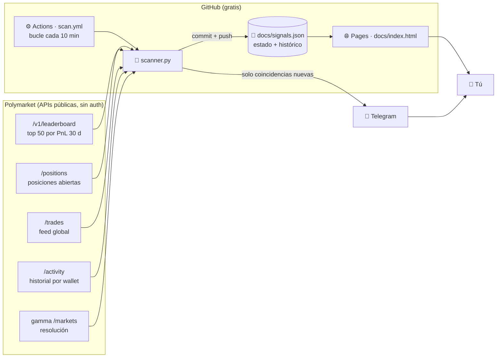
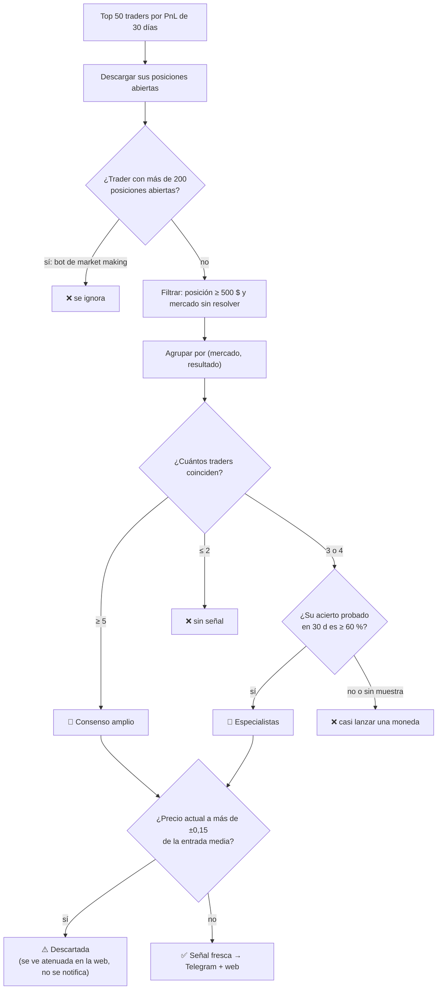
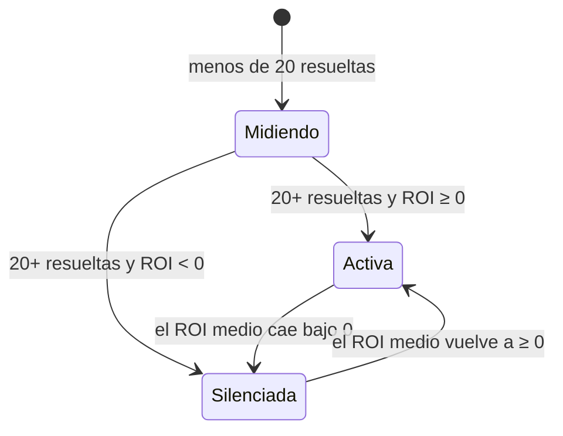

# 📡 Polymarket Smart Money

[](https://github.com/edulabrador/polymarket-smart-money/actions/workflows/scan.yml)
[](https://edulabrador.github.io/polymarket-smart-money/)


**Monitor de "dinero inteligente" en [Polymarket](https://polymarket.com).** Vigila a
los 50 traders más rentables del último mes y avisa cuando varios de ellos apuestan
lo mismo (mismo mercado y mismo resultado). Además lista las compras individuales
gigantes ("whales") de compradores rentables y **mide el ROI real de cada fuente**
para saber, con datos y no con intuición, si seguirlas da dinero.

📊 **Web en vivo: [edulabrador.github.io/polymarket-smart-money](https://edulabrador.github.io/polymarket-smart-money/)**


> ⚠️ Herramienta de análisis de datos públicos. **No apuesta, no ejecuta órdenes y no
> es consejo financiero.** Lee la sección [Limitaciones](#-limitaciones-y-riesgos)
> antes de sacar conclusiones de las cifras.

---

## Índice

- [La idea en 30 segundos](#-la-idea-en-30-segundos)
- [Resultados medidos](#-resultados-medidos)
- [Arquitectura](#-arquitectura)
- [Cómo se genera una señal](#-cómo-se-genera-una-señal)
- [Fuente secundaria: compras whale](#-fuente-secundaria-compras-whale)
- [Cómo se mide la rentabilidad](#-cómo-se-mide-la-rentabilidad)
- [La web](#-la-web)
- [Notificaciones por Telegram](#-notificaciones-por-telegram)
- [Configuración](#%EF%B8%8F-configuración)
- [Puesta en marcha](#-puesta-en-marcha)
- [Estructura del repositorio](#-estructura-del-repositorio)
- [Limitaciones y riesgos](#-limitaciones-y-riesgos)
- [Estado y referencias](#-estado-y-referencias)

---

## 💡 La idea en 30 segundos

En un mercado de predicción el precio es la probabilidad que el mercado asigna a un
resultado: comprar "Sí" a 0,30 $ significa que el mercado cree que ocurre un 30 % de
las veces, y si ocurre cobras 1 $.

**Hipótesis:** si **varios** de los traders más rentables están posicionados en el
**mismo lado** de un mercado, ese lado gana más a menudo de lo que dice su precio.
Un solo trader puede tener suerte o una apuesta puntual; cinco coincidiendo sin
coordinarse es información.

El proyecto no da la hipótesis por buena: **registra cada señal, espera a que el
mercado resuelva y calcula cuánto habrías ganado o perdido siguiéndola.** Las fuentes
que no pagan se silencian solas.

---

## 📈 Resultados medidos

Foto del histórico en vivo a **14 de octubre de 2026** (mercados resueltos entre julio
y octubre de 2026). Las cifras actualizadas están siempre en la web.

| Fuente | Señales resueltas | Aciertos | ROI medio por señal | Se notifica |
|---|---:|---:|---:|:---:|
| 👥 **Coincidencias** de top traders | 58 | 55 (95 %) | **+40 %** | ✅ Telegram |
| 🐋 **Compras whale** (≥ 50 000 $) | 1 789 | 1 093 (61 %) | **+4 %** | ❌ solo web |
| 🚶 Primer movimiento *(retirada)* | 91 | 26 % | **−42 %** | ❌ eliminada |

Cómo leer la tabla:

- **El ROI importa más que la tasa de acierto.** Acertar un favorito comprado a 0,95
  solo paga +5 %; fallar cuesta −100 %. Una fuente puede acertar el 90 % y perder dinero.
- **La fuente "primer movimiento"** (copiar la posición suelta de un único top trader)
  se retiró porque los datos la mostraron perdedora: acertaba menos de lo que ya
  implicaba el propio precio.
- **Las whales** son ligeramente positivas pero con un margen tan pequeño que no
  justifica interrumpir con avisos; se siguen midiendo en silencio.

> 🔍 **Ojo con el 95 %.** Son 58 señales, una muestra pequeña. El backtest inicial de 30
> días (ver más abajo) dio solo 4/24 aciertos con un método distinto y más pesimista.
> Además, en 54 de las 58 el precio se había movido más de 15 puntos desde la entrada
> en el último escaneo antes de resolver (normalmente porque iban ganando), así que
> el ROI depende mucho de entrar pronto. Trátalo como evidencia prometedora, no
> como prueba.

---

## 🏗 Arquitectura

Todo funciona **sin servidor y sin coste**: GitHub Actions hace de "cron", el propio
repositorio hace de base de datos (`docs/signals.json` versionado) y GitHub Pages
sirve la web.



Por qué así:

- **Polymarket está bloqueado en España** (DGOJ): los ISP españoles no resuelven
  `*.polymarket.com`. Los runners de GitHub Actions están en EE. UU. y no tienen ese
  problema, así que el escáner corre allí.
- **El cron de Actions no es fiable a 10 minutos** (GitHub retrasa o salta ejecuciones).
  Por eso el cron solo relanza cada ~3 h un job que hace **30 vueltas de escaneo con
  `sleep 600` entre ellas** (~5 h 30). En repos públicos los minutos de Actions son gratis.
- **El estado vive en git**: cada escaneo hace commit de `signals.json`. Sirve de base
  de datos, de histórico (`git log`) y de fuente de la web a la vez.
- **Solo librería estándar de Python** (`urllib`, `json`): nada que instalar.

---

## 🔬 Cómo se genera una señal

Cada 10 minutos `scanner.py` recorre este embudo:



Los pasos en detalle:

1. **Leaderboard.** Se descargan los 50 mejores traders por beneficio de los últimos
   30 días (`/v1/leaderboard?timePeriod=MONTH&orderBy=PNL`).
2. **Filtro anti-bots.** Los primeros puestos suelen ser bots que operan en cientos de
   mercados al día; sus posiciones no expresan una opinión. Un trader con más de
   `MAX_POSITIONS_PER_TRADER` (200) posiciones abiertas no cuenta.
3. **Filtro de ruido.** Solo cuentan posiciones de al menos `MIN_POSITION_USD` (500 $)
   en mercados no resueltos.
4. **Dos niveles de señal**, para encontrar más oportunidades sin perder fiabilidad:
   - **👥 Consenso amplio:** ≥ `MIN_USERS` (5) traders top en el mismo lado.
   - **🎯 Especialistas:** solo `MIN_USERS_SPECIALIST` (3) coinciden, pero su tasa de
     acierto **demostrada** en 30 días es ≥ `SPECIALIST_MIN_WINRATE` (60 %). Se mide en
     la categoría del mercado (deportes, política, cripto u otras) si hay muestra
     suficiente y, si no, en global. Adelanta la señal exigiendo gente que gana, no
     más gente.
5. **Descarte por deriva de precio.** Si el precio actual se ha alejado más de
   `MAX_PRICE_DRIFT` (0,15) del precio medio al que entraron los traders, la oportunidad
   que ellos vieron ya no existe: o ya ganaron ese tramo o el mercado les lleva la
   contraria. La señal se marca **descartada** y no se notifica.
6. **Especialización por categoría.** El historial de cada trader se desglosa por
   categoría (heurística por palabras del título). Un 70 % de acierto en deportes dice
   mucho en un partido y poco en unas elecciones, así que cada señal muestra el acierto
   de sus traders **en esa categoría**. Con menos de 5 mercados resueltos no se afirma nada.

### Cómo se mide el acierto de un trader

Polymarket no da directamente "este trader acertó X de Y". Se reconstruye desde el feed
`/activity` del wallet en los últimos 30 días:

- **Ganadas:** canjes `REDEEM` con pago. Solo canjeas con pago si tienes el lado ganador.
- **Perdidas:** posiciones en mercados ya resueltos que siguen en `/positions` sin valor.

Usar solo `/positions` daba un 0 % falso por **sesgo de supervivencia**: las posiciones
ganadoras se canjean y desaparecen de la lista; solo quedan las perdedoras.

---

## 🐋 Fuente secundaria: compras whale

Además de las coincidencias, el escáner lee el **feed global de trades** buscando
compras individuales grandes:

| Filtro | Valor por defecto | Motivo |
|---|---|---|
| Importe mínimo | `WHALE_MIN_USD` = 50 000 $ | Solo dinero con convicción |
| Precio máximo | `MAX_ALERT_PRICE` = 0,90 | Comprar a 0,99 no tiene recorrido ni aporta información; era la mayor fuente de ruido |
| **PnL neto 30 d del comprador** | > 0 | Ver abajo |
| Acierto (si no hay PnL suficiente) | `WHALE_MIN_WINRATE` = 55 % con ≥ 5 mercados | Respaldo cuando falta historial de dinero |

**Filtro de calidad por dinero, no por número de apuestas.** Se calcula el beneficio
neto de 30 días del comprador como flujo de caja real: lo que entra (ventas y canjes)
menos lo que sale (compras) más el valor de mercado de lo que sigue abierto. Una whale
con **PnL neto negativo no se guarda ni se muestra en ningún sitio**. Alguien que ganó
cincuenta apuestas de 50 $ pero perdió una de 20 000 $ va en negativo, y la tasa de
acierto por sí sola no lo detectaba. Las recompensas de market making (rewards,
rebates) se ignoran: se mide habilidad apostando, no minería de liquidez.

Etiquetas que verás en la web:

- **🕵 LONGSHOT:** compra a precio ≤ `LONGSHOT_MAX_PRICE` (0,30). Mucho dinero apostando
  a algo que el mercado considera improbable es la señal más informativa (posible
  información privilegiada).
- **TOP 50:** el comprador está además en el top vigilado.
- **×N:** cuántas compras grandes lleva ese wallet en la ventana reciente.


---

## 💰 Cómo se mide la rentabilidad

### ROI real por señal

Cuando aparece una señal se fija su **`entryPrice`**: el precio de mercado en ese
momento, que es al que podría entrar alguien que la siga. Cuando el mercado resuelve:

```
si gana:   ROI = (1 − entryPrice) / entryPrice
si pierde: ROI = −100 %
```

Ejemplos con una apuesta de 100 $:

| Precio de entrada | Si gana cobras | ROI si gana | ROI si pierde | Acierto necesario para no perder |
|---:|---:|---:|---:|---:|
| 0,95 | 105,26 $ | +5 % | −100 % | 95 % |
| 0,70 | 142,86 $ | +43 % | −100 % | 70 % |
| 0,30 | 333,33 $ | +233 % | −100 % | 30 % |

La última columna es la clave: **una fuente solo es rentable si acierta más que el
precio al que entra.** Por eso la métrica principal de la web es el ROI medio, no la
tasa de acierto.

El ganador se determina con el oráculo de gamma (`/markets`: `closed` y
`outcomePrices`, donde el precio "1" marca el resultado ganador).

### Indicadores de cada señal

- **`upside`** (potencial): ganancia por cada dólar si gana comprando ahora, `(1 − precio) / precio` (en la web, `×0,28` = +28 %).
- **`entryGap`**: cuánto se ha alejado el precio actual de la entrada media de los
  traders. Cuanto menor, menos tarde llegas.

### Gate auto-corrector por fuente

Cada fuente (coincidencias, whales) acumula su ROI real. Si llega a
`SOURCE_MIN_SAMPLE` (20) señales resueltas con **ROI medio negativo**, deja de notificar
por Telegram y aparece en la web marcada como *silenciada*. No es una decisión fija: si
las señales nuevas devuelven el ROI a positivo, se reactiva sola.



### Backtest

El workflow manual **`backtest`** (`backtest.py`) aplica las mismas reglas de
coincidencia a los mercados que resolvieron en los últimos 30 días y escribe
`docs/backtest.json`. La última ejecución (julio de 2026) dio **4/24 aciertos** en
consenso amplio. Es más pesimista que el histórico en vivo porque reconstruye
posiciones a posteriori y no tiene el precio de entrada real; sirve como contraste,
no como verdad.

---

## 🖥 La web

Página estática (HTML + JavaScript sin frameworks) servida desde `docs/` con GitHub Pages.
Lee `signals.json` y `backtest.json` y se adapta a tema claro/oscuro y a móvil.

**👥 Coincidencias** (pestaña principal):

- Tarjetas: señales frescas, descartadas, tasa de acierto, ROI medio y backtest.
- Panel de fuentes con el ROI real de cada una.
- Filtros: búsqueda, nivel de señal, categoría, ocultar favoritos (precio > 0,80, casi
  sin recorrido) y mostrar descartadas.
- Orden por número de traders, **potencial** o **mejor entrada**.
- Por señal: traders que coinciden (con enlace a su perfil), capital total, entrada
  media frente a precio actual, potencial y acierto medio global y por categoría.
- Histórico de coincidencias resueltas con su ROI.


**🐋 Compras whale:** lista de compras grandes filtradas, con el PnL y acierto del
comprador, y el histórico de whales resueltas con su ROI.

<p align="center">
  
</p>

---

## 📱 Notificaciones por Telegram

**Telegram solo avisa de coincidencias**, que es la única fuente que los datos
respaldan. Recibirás:

- 🆕 Señales nuevas frescas (no descartadas y con precio < 0,90).
- ✅/❌ Resolución de cada señal con su ROI.
- 📊 El hito de "muestra suficiente" cuando una fuente llega a 20 resueltas.

Las whales no interrumpen: se miden en silencio y solo se notificarían si el dato las
respaldase.

**Varios destinatarios:** `TELEGRAM_CHAT_ID` admite varios ids separados por comas. Para
umbrales distintos por persona usa `TELEGRAM_RECIPIENTS` (JSON):

```json
[
  {"chatId": "123456789", "minUsers": 7},
  {"chatId": "-100987654321", "minUsers": 5, "whaleMinUsd": 100000}
]
```

---

## ⚙️ Configuración

Todos los parámetros son variables de entorno con valor por defecto. Para cambiarlas en
producción, añádelas al bloque `env:` de `.github/workflows/scan.yml`.

| Variable | Defecto | Qué controla |
|---|---:|---|
| `TOP_N` | `50` | Cuántos traders del leaderboard se vigilan |
| `MIN_USERS` | `5` | Traders mínimos para una señal de consenso amplio |
| `MIN_USERS_SPECIALIST` | `3` | Traders mínimos para una señal de especialistas |
| `SPECIALIST_MIN_WINRATE` | `0.6` | Acierto mínimo probado de los especialistas |
| `MIN_POSITION_USD` | `500` | Tamaño mínimo de posición que cuenta |
| `MAX_PRICE_DRIFT` | `0.15` | Deriva de precio máxima antes de descartar la señal |
| `MAX_POSITIONS_PER_TRADER` | `200` | Por encima, el trader se considera bot y se ignora |
| `WHALE_MIN_USD` | `50000` | Importe mínimo de una compra whale |
| `MAX_ALERT_PRICE` | `0.9` | Precio máximo para whales y alertas (fuera casi-certezas) |
| `LONGSHOT_MAX_PRICE` | `0.3` | Precio máximo para la etiqueta 🕵 LONGSHOT |
| `WHALE_MIN_WINRATE` | `0.55` | Acierto mínimo de respaldo para whales sin PnL suficiente |
| `WHALE_MIN_TRACK` | `5` | Mercados resueltos mínimos para afirmar un acierto |
| `SOURCE_MIN_SAMPLE` | `20` | Señales resueltas antes de que el gate pueda silenciar una fuente |
| `TELEGRAM_TOKEN` | — | Token del bot (secret) |
| `TELEGRAM_CHAT_ID` | — | Chat id o lista separada por comas (secret) |
| `TELEGRAM_RECIPIENTS` | — | JSON con destinatarios y umbrales propios |

---

## 🚀 Puesta en marcha

### En tu propio fork

1. **Haz fork** del repositorio (público, para que los minutos de Actions sean gratis).
2. **Activa GitHub Pages:** *Settings → Pages → Deploy from a branch → `master` / `docs`*.
3. **Crea el bot de Telegram** (opcional): habla con [@BotFather](https://t.me/BotFather),
   `/newbot`, y apunta el token. Para tu chat id, escribe al bot y abre
   `https://api.telegram.org/bot<TOKEN>/getUpdates`.
4. **Añade los secrets:** *Settings → Secrets and variables → Actions* →
   `TELEGRAM_TOKEN` y `TELEGRAM_CHAT_ID`. Sin ellos el escáner funciona igual y solo
   omite los avisos.
5. **Activa los workflows** en la pestaña *Actions* y lanza `scan` a mano
   (*Run workflow*) para no esperar al cron.
6. (Opcional) Lanza `backtest` para generar `docs/backtest.json`.

### Workflows

| Workflow | Disparo | Qué hace |
|---|---|---|
| `scan` | cron cada ~3 h + manual | Bucle de 30 escaneos cada 10 min; commit de `signals.json` |
| `backtest` | manual | Recalcula `docs/backtest.json` con mercados resueltos en 30 días |
| `probe` | manual | Verifica los endpoints y regenera `tests/fixtures/` y `NOTES.md` |

### En local

Solo hace falta Python 3; no hay dependencias externas.

```bash
# tests: sin red, contra respuestas reales guardadas en tests/fixtures/
python tests/test_scanner.py
python tests/test_backtest.py
# o, si tienes pytest:
pytest

# un escaneo real (desde España necesitas VPN)
python scanner.py
```

Para ver la web en local: `python -m http.server -d docs` y abre `http://localhost:8000`.

---

## 📁 Estructura del repositorio

```
polymarket-smart-money/
├── scanner.py            # toda la lógica: APIs, señales, whales, ROI, gate, Telegram
├── backtest.py           # backtest de coincidencias sobre mercados ya resueltos
├── probe.py              # verificación de endpoints (genera NOTES.md y fixtures)
├── docs/                 # lo que sirve GitHub Pages
│   ├── index.html        # la web (HTML + JS vanilla)
│   ├── signals.json      # estado vivo e histórico (lo escribe el cron)
│   ├── backtest.json     # resultado del último backtest
│   └── img/              # capturas de este README
├── tests/
│   ├── test_scanner.py
│   ├── test_backtest.py
│   └── fixtures/         # respuestas reales de la API
├── .github/workflows/    # scan, backtest, probe
├── PLAN.md               # plan de desarrollo y decisiones
└── NOTES.md              # endpoints verificados
```

**Formato de `docs/signals.json`** (resumido):

| Clave | Contenido |
|---|---|
| `updatedAt`, `params` | Momento del último escaneo y parámetros usados |
| `signals` | Coincidencias abiertas: mercado, resultado, traders, capital, precios, `tier`, `stale`, `upside`, `entryGap` |
| `whales` | Últimas 100 compras whale con PnL y acierto del comprador |
| `history` | Señales resueltas con `entryPrice`, `won`, `roi` y `source` |
| `sourceStats` | Por fuente: resueltas, aciertos, ROI medio y si está silenciada |
| `trackRecords` | Caché (6 h) del historial de 30 días de cada wallet |

### APIs de Polymarket utilizadas

Todas públicas y sin autenticación (detalle en [NOTES.md](NOTES.md)):

| Endpoint | Uso |
|---|---|
| `data-api.polymarket.com/v1/leaderboard` | Top traders por PnL |
| `data-api.polymarket.com/positions` | Posiciones abiertas de cada trader |
| `data-api.polymarket.com/trades` | Feed global de compras (whales) |
| `data-api.polymarket.com/activity` | Historial del wallet: acierto y PnL neto |
| `gamma-api.polymarket.com/markets` | Resolución de mercados (oráculo del ROI) |

---

## ⚠️ Limitaciones y riesgos

- **Muestra pequeña.** 58 coincidencias resueltas no bastan para afirmar una ventaja
  estable; un par de fallos caros cambian mucho el ROI medio.
- **Llegar tarde cuesta.** Las posiciones del top pueden ser antiguas; el descarte por
  deriva lo mitiga, pero el ROI medido supone entrar en el primer escaneo que detecta la
  señal (hasta 10 min de retraso) y sin comisiones ni deslizamiento.
- **El leaderboard mezcla habilidad y suerte**, y su composición cambia cada mes.
- **API no oficial ni versionada.** Si Polymarket cambia un endpoint, el workflow
  `scan` falla (GitHub avisa por email) y hay que adaptar el código.
- **Categorías por heurística** de palabras del título: suficientes para filtrar, no
  perfectas.
- **Legalidad.** Polymarket está bloqueado por la DGOJ en España. Este proyecto solo lee
  datos públicos desde servidores de GitHub; apostar es responsabilidad de cada usuario
  y de la normativa de su país.

---

## 🗺 Estado y referencias

Plan completo y decisiones de diseño en [PLAN.md](PLAN.md).

- ✅ Fase 0: endpoints verificados ([NOTES.md](NOTES.md)) y fixtures reales
- ✅ Fase 1: `scanner.py` y tests sin red
- ✅ Fase 2: notificaciones por Telegram
- ✅ Fase 3: web en GitHub Pages
- ✅ Fase 4: escaneo automático cada 10 min
- ✅ Fase 5: descarte por deriva, filtro anti-bots, especialistas, whales filtradas por
  PnL, ROI real, gate auto-corrector y retirada de "primer movimiento"

Repos consultados como inspiración:

- [GottaTrackEmAll](https://github.com/thelastbodhisattva/GottaTrackEmAll): tracker de
  whales e insiders con scoring de 11 factores; de aquí la idea de registrar los
  resultados para medir el acierto.
- [darrnhard/polymarket-smart-money](https://github.com/darrnhard/polymarket-smart-money):
  análisis de 6,8 M de eventos de los mejores wallets que muestra que los primeros
  puestos son bots en 200-2 000 mercados al día; de aquí el filtro anti-bots.
- [al1enjesus/polymarket-whales](https://github.com/al1enjesus/polymarket-whales):
  tracker de trades grandes por polling y Telegram, misma filosofía sin infraestructura.
- [Awesome-Prediction-Market-Tools](https://github.com/aarora4/Awesome-Prediction-Market-Tools):
  catálogo del ecosistema; de herramientas como PolyInsider y PolyTrack viene la
  etiqueta LONGSHOT.
